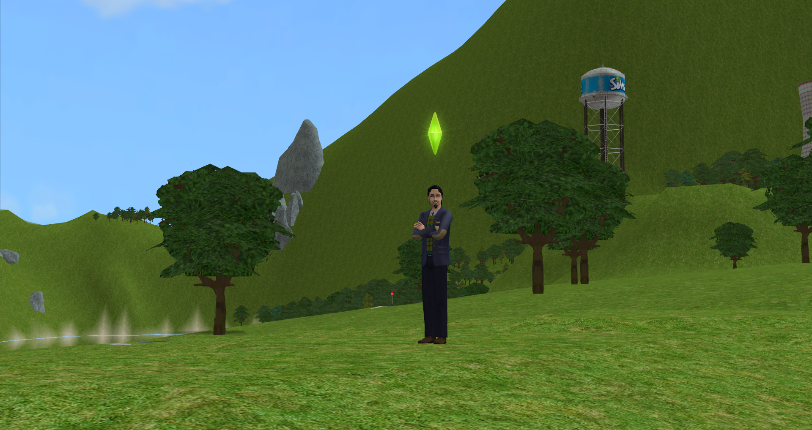
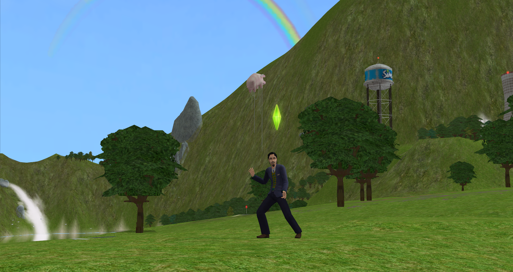
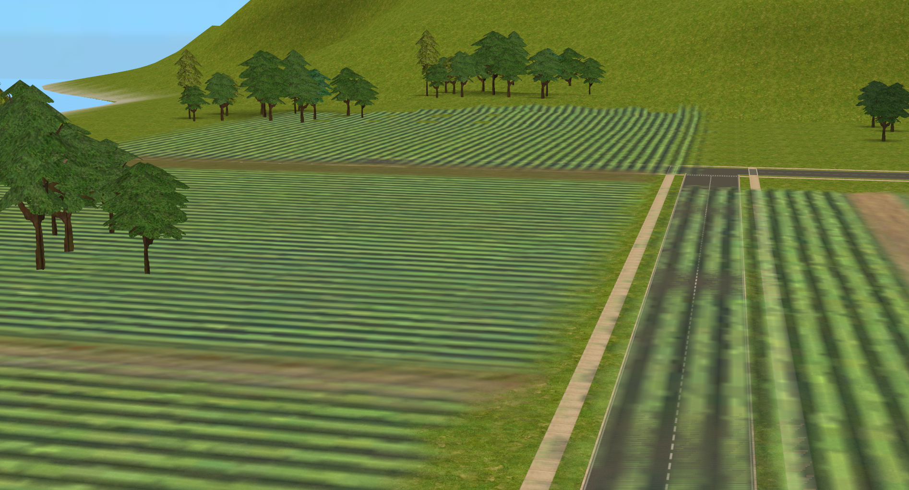
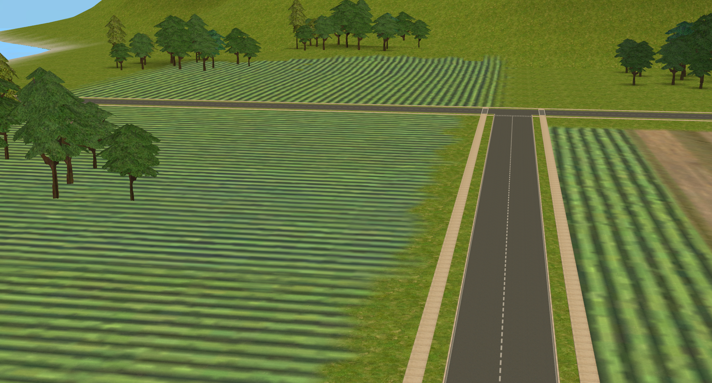

# TS2 Visible Hood FX
## About
Allows neighbourhood-exclusive details such as bridges, particle effects, and decals to appear in lot view.

| Vanilla | Mod |
| :-----: | :-: |
|  |  |

## Requirements
- The Sims 2: Ultimate Collection <ins>**OR**</ins> The Sims 2 disc version with all EPs and SPs.

- [Sims2RPC](https://modthesims.info/d/648220/sims2rpc-modded-sims-2-launcher-for-mansion-and-garden.html) <ins>**OR**</ins>
[Ultimate ASI Loader](https://github.com/ThirteenAG/Ultimate-ASI-Loader).

## Known Issues
- Decals that overlap the current lot bounds will be cut off.

- Decals may have square holes appear in them &mdash; this is caused by the depth testing/camera clipping formula the game uses.

## Installation
### <ins>Plugin</ins>
**Sims2RPC Users:**

1. Download `TS2VisibleHoodFX.zip`, found under the [Releases](https://github.com/spockthewok/TS2VisibleHoodFX/releases/latest) section of this repository.
2. Extract both `TS2VisibleHoodFX.asi` and `TS2VisibleHoodFX.ini` from the zip file to your `\TSBin\mods` directory, found wherever you have the Sims 2 installed.
   For example, on my machine, they would be extracted to:

   `E:\Games\The Sims 2\Fun with Pets\SP9\TSBin\mods`

**Ultimate ASI Loader Users:**

1. Download Ultimate ASI Loader from [here](https://github.com/ThirteenAG/Ultimate-ASI-Loader/releases/download/Win32-latest/dsound-Win32.zip).
2. Extract `dsound.dll` from the zip file and place it in the game's `\TSBin` directory. On my machine, it would go here:

   `E:\Games\The Sims 2\Fun with Pets\SP9\TSBin`
3. Download `TS2VisibleHoodFX.zip`, found under the [Releases](https://github.com/spockthewok/TS2VisibleHoodFX/releases/latest) section of this repository.
4. Extract both `TS2VisibleHoodFX.asi` and `TS2VisibleHoodFX.ini` from the zip file to the same `\TSBin` directory Ultimate ASI Loader was extracted to.

### <ins>Shaders</ins>
The mod also includes an edited lot skirt shader, which fixes an issue where decal effects would incorrectly draw on top of roads in lot view:

| Vanilla | Mod |
| :-----: | :-: |
|  |  |

To install, extract one of the `.package` files within the `Shaders` folder in `TS2VisibleHoodFX.zip` to your Sims 2 `\Downloads` directory. Which version
you choose depends on which of these mods you use:

- <ins>Sky Fix</ins>: [Sky Fix](https://modthesims.info/d/569032/sky-fix.html).

- <ins>Dreadpirate</ins>: [Dreadpirate's Shader Fixes](https://www.tumblr.com/dreadpirate/179182314487/blue-snow-no-more-shader-fixes-ive-included).

- <ins>Maxis</ins>: None of the above.

> [!IMPORTANT]
> You do not need to install these shaders if you are using Christaskyy's
> [Improved Shaders](https://www.tumblr.com/christaskyy/821768821608169472/ts2-improved-shaders).

## Configuration
### <ins>Blacklist</ins>
The included `TS2VisibleHoodFX.ini` file contains all of the effects blacklisted from appearing in lot view. Effects can be blacklisted by adding them to the
config file and vice versa.

The blacklist is split into two sections:
- <ins>**Global**</ins>: Prevents effects being created anywhere in lot view.

- <ins>**Lots**</ins>: Prevents effects being created within the boundaries of the current lot. For example, if you add the musical notes effect to the lot blacklist
  and place it at Lots A and B in-game, only the effect over Lot B will be visible while playing Lot A etc.

Each effect you wish to blacklist should be on a separate line &mdash; an example of the correct structure can be seen below:

```
[Global]
effect1 = nhood_object1_name
effect2 = nhood_object2_name
effect3 = nhood_object3_name

[Lots]
effect1 = nhood_object1_name
effect2 = nhood_object2_name
effect3 = nhood_object3_name
```

To blacklist no effects, simply leave the sections empty:

```
[Global]

[Lots]
```

> [!NOTE]
> The name of the neighbourhood object that creates the effect should be added to the blacklists, rather than the name of the effect itself.
>
> For a list of all of the effect objects in the vanilla game, see [here](https://github.com/spockthewok/TS2VisibleHoodFX/blob/main/EFFECTS.md).

### <ins>Other Options</ins>
- `waterSparkles`: Enables/disables the neighbourhood water sparkle effect in lot view.

  *Default value = false*
- `lotBridges`: Enables/disables neighbourhood bridges in lot view.

  *Default value = true*

## Recommended Mods
[No Neighbourhood Effect Rocks](https://mechemik.tumblr.com/post/76558980499/hey-guys-i-bring-for-you-a-small-little-fix) by Chemic &mdash; hides the unnecessary
boulder model that certain effects place.

## Thanks
[metayeti](https://github.com/metayeti), for [mINI](https://github.com/metayeti/mINI/).

[LazyDuchess](https://github.com/LazyDuchess), for the hooking code used in this mod.

[dreadpirate](https://www.tumblr.com/dreadpirate), for their [shader fixes](https://www.tumblr.com/dreadpirate/179182314487/blue-snow-no-more-shader-fixes-ive-included).

[Nopke](https://modthesims.info/m/9742948), for [Sky Fix](https://modthesims.info/d/569032/sky-fix.html).